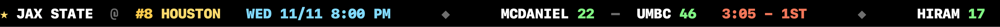

# 🏀 Hoops Ticker

A scrolling, LED-style men's college basketball score ticker for your Mac.



## Features

- **Every Division I game.** Live scores, today's finals and upcoming tip times, with AP rankings next to ranked teams.
- **Follow your favorite team.** Pick any of the 365 D1 teams. Its game always scrolls first, whether it's live, today's final, or a game a week away.
- **Looks ahead.** Top 25 teams with no game today show their next game, up to 6 days out, so the ticker is never empty on an off night.
- **AP Top 25 in the menu bar.** The full poll with records, plus a live-game count on the 🏀 icon.
- **Your choice of display.** Top 25 games only, show or hide finals and upcoming games, three scroll speeds, top or bottom of the screen.
- **Small and native.** Written in Swift with AppKit. No Electron, no account, no ads, no tracking.

## Install

1. Download **Hoops Ticker.dmg** from the [latest release](../../releases/latest).
2. Open it and drag **Hoops Ticker** into **Applications**.
3. Launch it. The ticker appears along the bottom of your screen and 🏀 appears in the menu bar.

Requires macOS 12 or later. Runs on Apple Silicon and Intel Macs.

## Using it

Click 🏀 in the menu bar for:

- **Settings…** to choose your favorite team, position, scroll speed and which games to show
- **Hide / Show Ticker**
- **AP Top 25**
- **Refresh Now**

You can also right-click the ticker to open the same menu.

## Build from source

You need Xcode or the Swift toolchain (Swift 5.9 or later).

```bash
git clone https://github.com/GeekNerdCarp/ncaa-hoops-ticker.git
cd ncaa-hoops-ticker
./build.sh
open "dist/Hoops Ticker.app"
```

`build.sh` produces an ad-hoc signed universal app, which is enough to run it on your own Mac. To make a signed, notarized DMG for sharing, see `release.sh`.

## Where the data comes from

Scores, schedules, teams and rankings come from ESPN's public scoreboard API. That API isn't officially documented, so ESPN could change it at any time. The ticker refreshes every 20 seconds while games are live and every 2 minutes otherwise.

This project isn't affiliated with or endorsed by ESPN or the NCAA.

## License

[GPL-3.0](LICENSE). You're free to use, modify and share this code, and any version you distribute must stay open source under the same license.

© 2026 GeekNerdCarp
